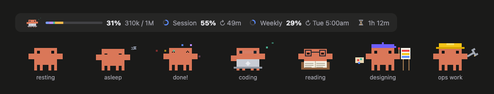

# usage-band

A Claude Code mod that puts your session at a glance in one line above the prompt: Clawd showing what Claude is doing, how full the context window is, your session and weekly rate limits, and how long you've spent working.



## What it shows

- **Clawd**, who changes with the work:
  - **resting**: breathing and blinking when nothing runs
  - **asleep**: after 3 minutes idle
  - **done!**: a short celebration when an answer lands
  - **coding**: at a laptop while Claude edits code
  - **reading**: in glasses over a book while Claude reads, searches or thinks
  - **designing**: beret, easel and brush for CSS, SVG, Figma and design skills
  - **ops work**: hard hat and wrench for shell commands and other tooling

  Clawd sweats when the context is past 85% or a limit is past 90%.
- **Context window**: a bar coloured by what fills it (system prompt, tools, MCP, memory, messages), the percentage, and tokens used out of the window.
- **Rate limits**: a ring per window (session, weekly) with the percentage and when it resets. It turns yellow at 70% and red at 90%.
- **Time spent working**: the sum of Claude's turns, from your message to its answer. The time between messages doesn't count, and it carries over when you resume a session.

The band always stays one line. When the window is narrow, the context bar gives up the room. In a terminal the bars are drawn in text.

## Install

At the prompt of a Claude Code session in a terminal:

```
/plugin install usage-band --marketplace kotays12/claude-usage-band
```

Answer `y` to add the marketplace, then pick the **user** scope so the band shows in every session, the desktop app's Code tab included.

## Requirements

- A Claude Code build that loads function-hook plugins (mods).
- Rate limits appear on a Claude subscription. With an API key the band shows the context window and the work time only.

## Develop

```
claude --plugin-dir ./usage-band
claude plugin validate ./usage-band
claude plugin test ./usage-band
```

`hooks/register.tsx` holds the hooks, `hooks/mascot.ts` Clawd's poses, `hooks/scene.ts` the bars, rings and hourglass, and `hooks/activity.ts` how a tool call maps to a pose.

## Credits

Clawd is Anthropic's Claude Code mascot. This is an unofficial fan mod, not affiliated with or endorsed by Anthropic.

Clawd's pixel grid and colour come from [ClawdMoji](https://github.com/afspies/ClawdMoji) (MIT). The idea of moods for thinking, working, done and idle comes from [claude-code-mascot-statusline](https://github.com/TeXmeijin/claude-code-mascot-statusline).

## License

[MIT](LICENSE)
